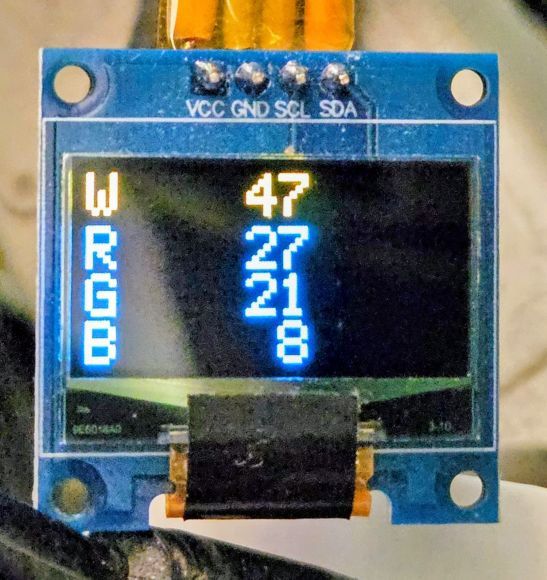

# RGBmeter

A pocket RGBW meter built on ESP32-S3 for measuring the brightness and color
balance of light sources - displays, LEDs and others. Readings come from a
VEML6040 color sensor and are shown on the device's own small OLED display.
Optional temperature, humidity and air pressure monitoring uses a Bosch BME68x
sensor.

<p align="center">
  
</p>

Written in C++14 on top of ESP-IDF 5.5. VS Code was used for hacking.

## Features

- **RGB meter** (default screen after power-up): raw 16-bit counts of the
  W (white), R, G and B channels, updated 5 times per second.
- **Climate** screen: temperature, relative humidity and air pressure
  from the BME68x (in progress, the screen is a placeholder for now).
- One button switches between the screens.

## About the readings

The values are raw sensor counts (0 to 65535 per channel), not calibrated
photometric or colorimetric units. The VEML6040 color filters do not follow
the CIE color matching functions, so the readings are not absolute color
coordinates or color temperature. They are well suited for relative
measurements: comparing light sources of the same kind with each other, or
tracking how one source changes over time.

For repeatable results, keep the sensor at the same position and distance
from the source and shield it from ambient light.

## Hardware

| Part | Interface | Address / pin |
|---|---|---|
| ESP32-S3 Super Mini (4 MB flash) | USB (Serial/JTAG) | - |
| Vishay VEML6040 RGBW color sensor | I2C | 0x10 |
| SSD1306 OLED 128x64 (yellow/blue) | I2C | 0x3C |
| Bosch BME68x environmental sensor | I2C | 0x77 |
| Push button to GND | GPIO | GPIO11 |

### Wiring

| ESP32-S3 | Connects to |
|---|---|
| GPIO12 | SDA (all I2C modules) |
| GPIO13 | SCL (all I2C modules) |
| GPIO11 | Button, other side to GND |
| 3V3 | VCC of all modules |
| GND | GND of all modules |

The internal pull-ups are enabled on SDA, SCL and the button pin. Most
breakout modules already carry their own I2C pull-up resistors.

## Software

- ESP-IDF 5.5, C++14, VS Code
- [chill-sam/ssd1306](https://components.espressif.com/components/chill-sam/ssd1306)
  OLED driver, pulled in automatically by the IDF Component Manager

### Architecture

The code is split into three layers. The application logic depends only on
small interfaces, so it does not know which sensor or display is behind them.

```
main/                 composition root: creates the hardware objects,
                      wires them into App, runs the main loop
components/core/      App and the interfaces: IColorSensor, IDisplay, IButton
                      (no ESP-IDF dependencies)
components/drivers/   ESP-IDF implementations of the interfaces
```

| Class | Role |
|---|---|
| `App` | Main loop step: handles the button, reads the sensor of the current screen, renders it |
| `I2cBus` | Owns the I2C master bus (RAII) |
| `Veml6040` | VEML6040 driver, written from the datasheet |
| `Ssd1306Display` | Adapter from `IDisplay` to the chill-sam/ssd1306 library |
| `GpioButton` | Button with timer-based debounce (10 ms sampling, 30 ms stable) |

### Project structure

```
RGBmeter/
  CMakeLists.txt
  sdkconfig.defaults
  dependencies.lock
  main/
    main.cpp
  components/
    core/
      include/   App.h, IButton.h, IColorSensor.h, IDisplay.h
      App.cpp
    drivers/
      include/   I2cBus.h, Veml6040.h, Ssd1306Display.h, GpioButton.h
      I2cBus.cpp, Veml6040.cpp, Ssd1306Display.cpp, GpioButton.cpp
      idf_component.yml
```

## Build and flash

Requires ESP-IDF 5.5. From an ESP-IDF terminal:

```
git clone https://github.com/<user>/RGBmeter.git
cd RGBmeter
idf.py set-target esp32s3
idf.py -p <PORT> flash monitor
```

`<PORT>` is the serial port of the board, for example `COM23` on Windows or
`/dev/ttyACM0` on Linux.

## Configuration

| Setting | Where | Value |
|---|---|---|
| I2C and button pins | `main/main.cpp` | SDA GPIO12, SCL GPIO13, button GPIO11 |
| Screen refresh period | `main/main.cpp` | 200 ms |
| VEML6040 integration time | `components/drivers/Veml6040.cpp` | 160 ms (up to about 4100 lux on G) |

## Roadmap

- Climate screen with BME68x readings
- Sleep mode for battery operation
- Settings
- Storing reference RGBW values
