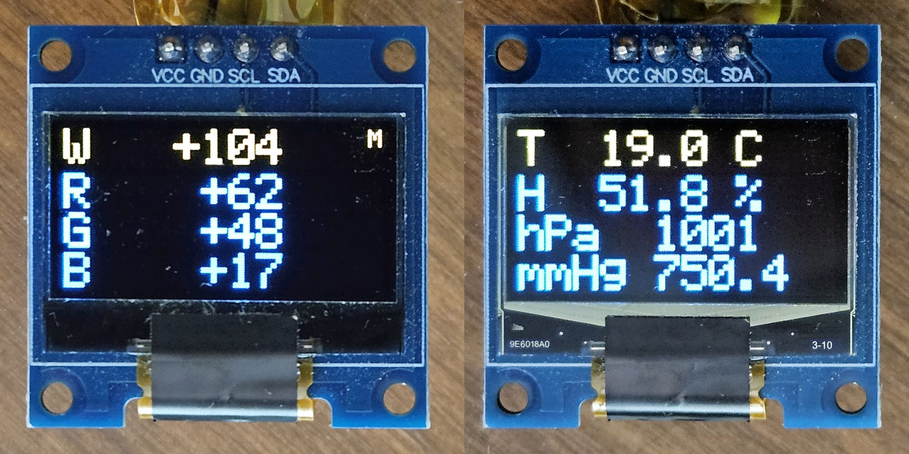

# RGBmeter

A pocket RGBW meter built on ESP32-S3 for measuring the brightness and color
balance of light sources - displays, LEDs and others. Readings come from a
VEML6040 color sensor and are shown on the device's own small OLED display.
Optional temperature, humidity and air pressure monitoring uses a Bosch BME68x
sensor.

<p align="center">
  
</p>

Written in C++14 on top of ESP-IDF 5.5. VS Code was used for hacking.

## Features

- **RGB meter** (default screen after power-up): raw 16-bit counts of the
  W (white), R, G and B channels, updated 5 times per second.
- **Memory**: save the current RGBW reading as a reference and see how the
  light differs from it, as signed values per channel (for example `W -44`,
  `G +11`, `B 0`). A small `M` in the top right corner shows that the
  reference is active.
- **Climate** screen: temperature (C), relative humidity (%) and air pressure
  (hPa and mmHg) from the BME68x.
- Two buttons with short and long clicks.

## Controls

| Button | Short click | Long click (1 s) |
|---|---|---|
| Button 1 (GPIO11) | Switch between the RGB and Climate screens | Reserved |
| Button 2 (GPIO10) | RGB screen: save the current reading as the reference | RGB screen: clear the reference |

- A short click is reported when the button is released, a long click as soon
  as the button has been held for 1 second. Holding it longer does not repeat
  the long click.
- Button 2 does nothing on the Climate screen.
- The reference survives switching between screens. It is kept in RAM only and
  is lost on power-off.

## About the readings

The values are raw sensor counts (0 to 65535 per channel), not calibrated
photometric or colorimetric units. The VEML6040 color filters do not follow
the CIE color matching functions, so the readings are not absolute color
coordinates or color temperature. They are well suited for relative
measurements: comparing light sources of the same kind with each other, or
tracking how one source changes over time. Memory differences are in the same
raw counts.

For repeatable results, keep the sensor at the same position and distance
from the source and shield it from ambient light.

## Hardware

| Part | Interface | Address / pin |
|---|---|---|
| Nologo ESP32-S3 Super Mini (4 MB flash) | USB (Serial/JTAG) | - |
| Vishay VEML6040 RGBW color sensor | I2C | 0x10 |
| SSD1306 OLED 128x64 (yellow/blue) | I2C | 0x3C |
| Bosch BME68x environmental sensor | I2C | 0x77 |
| Two push buttons to GND | GPIO | GPIO11, GPIO10 |

- [github.com/WMnologo](https://web.archive.org/web/20250502125222/https://github.com/WMnologo)
  ESP32-S3 Super Mini board author archived GitHub repository
- [ESP32-S3 Super Mini CS](media/Nologo_ESP32-S3_SuperMini_CS.png)
  ESP32-S3 Super Mini board original circuit schematics by Nologo
- [ESP32-S3 Super Mini Wiki](https://www.espboards.dev/esp32/esp32-s3-super-mini)
  ESP32-S3 Super Mini Pinout and resources from ESPboards

### Wiring

| ESP32-S3 | Connects to |
|---|---|
| GPIO12 | SDA (all I2C modules) |
| GPIO13 | SCL (all I2C modules) |
| GPIO11 | Button 1, other side to GND |
| GPIO10 | Button 2, other side to GND |
| 3V3 | VCC of all modules |
| GND | GND of all modules |

The internal pull-ups are enabled on SDA, SCL and both button pins. Most
breakout modules already carry their own I2C pull-up resistors.

## Software

- ESP-IDF 5.5, C++14, VS Code
- [chill-sam/ssd1306](https://components.espressif.com/components/chill-sam/ssd1306)
  OLED driver, pulled in automatically by the IDF Component Manager
- [Bosch BME68x SensorAPI](https://github.com/boschsensortec/BME68x_SensorAPI),
  included unmodified in `components/bme68x` (BSD-3-Clause)

### Architecture

The code is split into three layers. The application logic depends only on small
interfaces, so it does not know which sensor or display is behind them.

```
main/                 composition root: creates the hardware objects,
                      wires them into App, runs the main loop
components/core/      App and the interfaces: IColorSensor, IClimateSensor,
                      IDisplay, IButton (no ESP-IDF dependencies)
components/drivers/   ESP-IDF implementations of the interfaces
components/bme68x/    Bosch BME68x SensorAPI (third-party, unmodified)
```

| Class | Role |
|---|---|
| `App` | Main loop step: handles the buttons and the memory, reads the sensor of the current screen, renders it |
| `I2cBus` | Owns the I2C master bus (RAII) |
| `Veml6040` | VEML6040 driver, written from the datasheet |
| `Bme688` | Adapter from `IClimateSensor` to the Bosch BME68x SensorAPI (forced mode, gas heater off) |
| `Ssd1306Display` | Adapter from `IDisplay` to the chill-sam/ssd1306 library |
| `GpioButton` | Button with timer-based debounce (10 ms sampling, 30 ms stable) and short/long click detection |

### Project structure

```
RGBmeter/
  CMakeLists.txt
  sdkconfig.defaults
  dependencies.lock
  main/
    main.cpp
  components/
    core/
      include/   App.h, IButton.h, IClimateSensor.h, IColorSensor.h, IDisplay.h
      App.cpp
    drivers/
      include/   I2cBus.h, Veml6040.h, Bme688.h, Ssd1306Display.h, GpioButton.h
      I2cBus.cpp, Veml6040.cpp, Bme688.cpp, Ssd1306Display.cpp, GpioButton.cpp
      idf_component.yml
    bme68x/
      bme68x.c, bme68x.h, bme68x_defs.h, LICENSE
```

## Build and flash

Requires ESP-IDF 5.5. From an ESP-IDF terminal:

```
git clone https://github.com/elutsk/RGBmeter.git
cd RGBmeter
idf.py set-target esp32s3
idf.py -p <PORT> flash monitor
```

`<PORT>` is the serial port of the board, for example `COM23` on Windows or
`/dev/ttyACM0` on Linux.

## Configuration

| Setting | Where | Value |
|---|---|---|
| I2C and button pins | `main/main.cpp` | SDA GPIO12, SCL GPIO13, button 1 GPIO11, button 2 GPIO10 |
| Screen refresh period | `main/main.cpp` | 200 ms |
| VEML6040 integration time | `components/drivers/Veml6040.cpp` | 160 ms (up to about 4100 lux on G) |
| Long click time | `components/drivers/GpioButton.cpp` | 1000 ms |

## Roadmap

- Automatic sensitivity: choose the VEML6040 integration time from the light level
- Power saving on a long click of button 1 (display off, sleep)
- Battery operation: battery level and USB power detection
- Status indication with the on-board RGB LED
- Support for other temperature and humidity sensors (for example BME280)
- Settings
