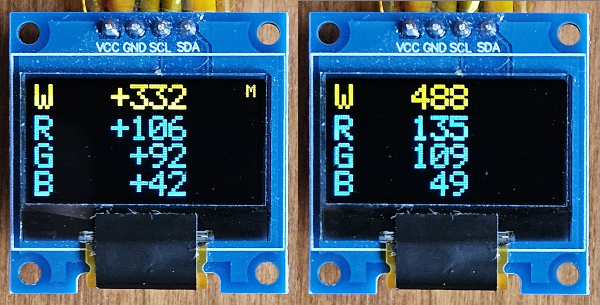
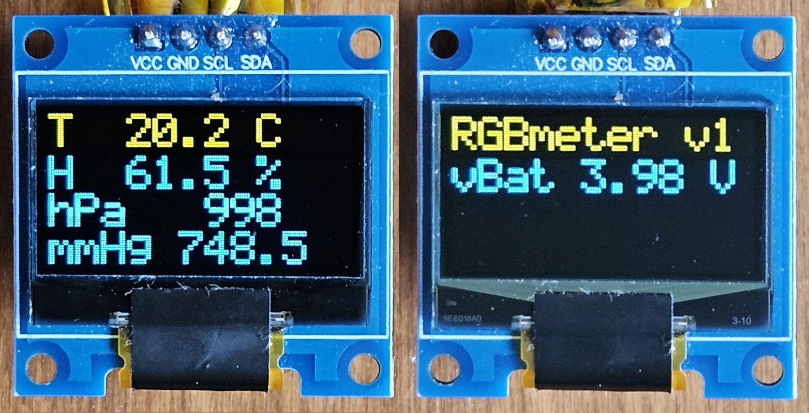
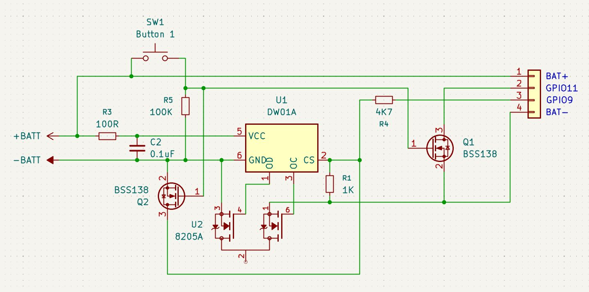

# RGBmeter

A pocket RGBW meter built on ESP32-S3 for measuring the brightness and color
balance of light sources - displays, LEDs and others. Readings come from a
VEML6040 color sensor and are shown on the device's own small OLED display.
Optional temperature, humidity and air pressure monitoring uses a Bosch BME68x
sensor.

<p align="center">
  
</p>

- Handwritten in C++14 on top of ESP-IDF 5.5. 
- VS Code was used for hacking. 

<p align="center">
  
</p>

## Features

- **RGB meter** (default screen after power-up): raw 16-bit counts of the
  W (white), R, G and B channels, updated 5 times per second.
- **Memory**: save the current RGBW reading as a reference and see how the
  light differs from it, as signed values per channel (for example `W -44`,
  `G +11`, `B 0`). A small `M` in the top right corner shows that the
  reference is active.
- **Climate** screen: temperature (C), relative humidity (%) and air pressure
  (hPa and mmHg) from the BME68x.
- **Status** screen: firmware name and version, power source and voltage
  (`vBus` on USB, `vBat` on battery).
- **Battery operation**: USB or battery power is detected automatically. On
  battery the on-board RGB LED gives a short flash every 10 seconds: green
  normally, red when the battery is low.
- **Power off**: a long click of button 1 on any screen switches the device
  off, holding button 1 for about 1 second switches it on again. On battery the
  power is cut completely by the battery protection board, on USB the device
  goes to deep sleep. On battery the device also switches off by itself after
  10 minutes without any button press, or when the battery is empty.
- **Startup indication** with the on-board RGB LED: a quick red-green-blue
  self-test, then green for 1 second when all devices are up, or steady red if
  any device failed to start (the reason is printed to the serial log).
- Two buttons with short and long clicks.

## Controls

| Button | Screen | Short click | Long click (1 s) |
|---|---|---|---|
| Button 1 (GPIO11) | RGB, Climate | Switch between the RGB and Climate screens | Power off |
| Button 1 (GPIO11) | Status | Ignored (reserved for settings) | Power off |
| Button 1 (GPIO11) | Off or sleeping | - | Switch on (hold for about 1 s) |
| Button 2 (GPIO10) | RGB | Save the current reading as the reference | Clear the reference |
| Button 2 (GPIO10) | Climate | Open the Status screen | - |
| Button 2 (GPIO10) | Status | Back to the Climate screen | - |

- A short click is reported when the button is released, a long click as soon
  as the button has been held for 1 second. Holding it longer does not repeat
  the long click.
- The reference survives switching between screens. It is kept in RAM only and
  is lost on power-off and in deep sleep.
- A short press while the device is off is ignored: the device starts for a
  moment, sees that the button is no longer held and switches off again.

## About the readings

The values are raw sensor counts (0 to 65535 per channel), not calibrated
photometric or colorimetric units. The VEML6040 color filters do not follow
the CIE color matching functions, so the readings are not absolute color
coordinates or color temperature. They are well suited for relative
measurements: comparing light sources of the same kind with each other, or
tracking how one source changes over time. Memory differences are in the same
raw counts.

For repeatable results, keep the sensor at the same position and distance
from the source and shield it from ambient light.

## Power and battery

On the Super Mini board a Li-ion cell feeds VBUS through a Schottky diode, and
VBUS is measured by the ADC on GPIO3 through an on-board 100k/100k divider.

- Above 4.4 V on VBUS the device is on USB, and the Status screen shows `vBus`.
  Otherwise it runs from the battery and shows `vBat`.
- The battery voltage is estimated as the measured VBUS plus a fixed
  correction for the diode drop and the ADC offset, calibrated against a
  multimeter (within about 30 mV).
- The battery level is linear between 3.4 V (0 %) and 4.2 V (100 %). Below
  about 3.3-3.35 V on the battery the ESP32 shuts down.
- On battery the RGB LED flashes for 100 ms every 10 seconds: green from 20 %
  up, red below 20 %.
- Battery guard: when the battery is below 0 % (3.4 V) in three checks in a
  row, 10 seconds apart, the device switches off. A single low reading does not
  count, it may be noise or a short dip under load.
- On battery, 10 minutes without any button press also switch the device off.
  The time starts again from zero when USB is disconnected.

The board has its own TP4054 Li-ion charger. When USB is connected, the cell
is charged up to 4.2 V at about 100 mA (10k PROG resistor), and a blue LED on
the board lights while charging. The board itself has no deep discharge
cut-off: the cell is connected through a DW01A + 8205A protection board, which
also works as the power switch.

### Power switch

Even in deep sleep the Super Mini board draws about 0.9 mA from the battery
(measured): the WS2812 alone takes about half of it, the ME6217 LDO more than
100 uA. So on battery the device does not sleep, it switches itself off with
the help of the battery protection board, without any change on the Super
Mini board:

<p align="center">
  
</p>

- **Off**: GPIO9 drives the CS input of the DW01A high through 4.7k. The DW01A
  takes it as a discharge overcurrent and turns the discharge MOSFET off: the
  whole device loses power. The DW01A stays in this state, because the device
  is still connected as a load. Only the DW01A itself stays powered, and
  charging keeps working.
- **On**: button 1 connects the cell plus to node X. Q2 pulls CS to the cell
  minus, the DW01A releases the protection and the device starts. The firmware
  then keeps GPIO9 low. A start without a long press switches the device off
  again.
- **Reading the button**: Q1 turns the same node X into an active low signal on
  GPIO11, so the firmware reads button 1 the same way as button 2.
- While button 1 is held, the discharge overcurrent and short-circuit
  protection of the DW01A does not work.
- On USB the device is powered from VBUS anyway, so the power switch has no
  effect there: the device goes to deep sleep instead, and flashing works
  without pressing any button.

### Deep sleep

Used on USB. Before sleeping, and also before the power cut on battery, the
device turns off the RGB LED, puts the OLED into sleep mode (display and charge
pump off) and the VEML6040 into shutdown. The BME68x needs nothing: in forced
mode it sleeps between measurements by itself. GPIO48 is held low during
sleep, so the on-board red LED on the same pin stays dark.

Waking up from deep sleep is a full restart, the same as after power-on. The
USB serial port also sleeps: to flash a sleeping board, wake it up first or
hold BOOT and press RST.

## Hardware

| Part | Interface | Address / pin |
|---|---|---|
| Nologo ESP32-S3 Super Mini (4 MB flash) | USB (Serial/JTAG) | - |
| Vishay VEML6040 RGBW color sensor | I2C | 0x10 |
| SSD1306 OLED 128x64 (yellow/blue) | I2C | 0x3C |
| Bosch BME68x environmental sensor | I2C | 0x77 |
| Button 1, read through the power switch (Q1) | GPIO | GPIO11 |
| Button 2 to GND | GPIO | GPIO10 |
| On-board WS2812 RGB LED | RMT | GPIO48 |
| On-board red LED (1k to GND), same pin as the WS2812 data | - | GPIO48 |
| On-board VBUS divider (100k/100k) | ADC1 | GPIO3 |
| On-board TP4054 Li-ion charger | - | - |
| Li-ion cell (optional) | Battery input | - |
| DW01A + 8205A battery protection board with the power switch (Q1, Q2 BSS138) | GPIO | GPIO9 (CS through 4.7k), GPIO11 (button 1) |

- [Super Mini Official](https://www.nologo.tech/en/product/esp32/esp32s3supermini/)
  ESP32-S3 Super Mini board author official website in Chinese
- [ESP32-S3 Super Mini CS](media/Nologo_ESP32-S3_SuperMini_CS.png)
  ESP32-S3 Super Mini board original circuit schematics by Nologo
- [ESP32-S3 Super Mini Wiki](https://www.espboards.dev/esp32/esp32-s3-super-mini)
  ESP32-S3 Super Mini Pinout and resources from ESPboards

### Wiring

| ESP32-S3 | Connects to |
|---|---|
| GPIO12 | SDA (all I2C modules) |
| GPIO13 | SCL (all I2C modules) |
| GPIO11 | Button 1, through Q1 on the protection board |
| GPIO10 | Button 2, other side to GND |
| GPIO9 | CS of the DW01A, through 4.7k on the protection board |
| BAT+, BAT- | BAT+ and BAT- of the protection board |
| 3V3 | VCC of all modules |
| GND | GND of all modules |

The internal pull-ups are enabled on SDA, SCL and both button pins. Most
breakout modules already carry their own I2C pull-up resistors.

## Software

- ESP-IDF 5.5, C++14, VS Code
- [elutsk/esp-ssd1306](https://github.com/elutsk/esp-ssd1306), a fork of
  [chill-sam/ssd1306](https://components.espressif.com/components/chill-sam/ssd1306)
  OLED driver with sleep/wake support and a fix for failed initialization
  (both offered upstream), pulled in from git by the IDF Component Manager
- [espressif/led_strip](https://components.espressif.com/components/espressif/led_strip)
  WS2812 driver (RMT), pulled in automatically by the IDF Component Manager
- [Bosch BME68x SensorAPI](https://github.com/boschsensortec/BME68x_SensorAPI),
  included unmodified in `components/bme68x` (BSD-3-Clause)

### Architecture

The code is split into three layers. The application logic depends only on small
interfaces, so it does not know which sensor or display is behind them.

```
main/                 composition root: creates the hardware objects,
                      wires them into App, runs the main loop
components/core/      App, power logic and the interfaces: IColorSensor,
                      IClimateSensor, IVoltageSensor, IDisplay, IRgbLed,
                      IButton (no ESP-IDF dependencies)
components/drivers/   ESP-IDF implementations of the interfaces
components/bme68x/    Bosch BME68x SensorAPI (third-party, unmodified)
```

| Class / function | Role |
|---|---|
| `App` | Main loop step: handles the buttons and the memory, reads the sensor of the current screen, renders it, checks the battery and the automatic sleep conditions, requests sleep |
| `evaluatePower()` | Pure function: power source, corrected voltage and battery level from the measured VBUS |
| `I2cBus` | Owns the I2C master bus (RAII) |
| `Veml6040` | VEML6040 driver, written from the datasheet, with shutdown for sleep |
| `Bme688` | Adapter from `IClimateSensor` to the Bosch BME68x SensorAPI (forced mode, gas heater off) |
| `Ssd1306Display` | Adapter from `IDisplay` to the ssd1306 library, waits for the panel warm-up after power-up, sleep mode |
| `Ws2812Led` | Adapter from `IRgbLed` to the led_strip component, timed pulses with a one-shot esp_timer |
| `AdcVoltage` | ADC one-shot reading behind a resistive divider, eFuse calibration, averaging |
| `GpioButton` | Button with timer-based debounce (10 ms sampling, 30 ms stable) and short/long click detection |
| `DeepSleep` | Deep sleep with wake-up by button 1 (ext0), start confirmation by a long press |
| `PowerSwitch` | Cuts the battery power through the CS input of the DW01A protection IC |
| `decideStart()` | Pure function: normal start, or start confirmation by button 1, from the start cause and the power source |

### Project structure

```
RGBmeter/
  CMakeLists.txt
  sdkconfig.defaults
  dependencies.lock
  main/
    main.cpp
  components/
    core/
      include/   App.h, Power.h, IButton.h, IClimateSensor.h, IColorSensor.h,
                 IDisplay.h, IRgbLed.h, IVoltageSensor.h
      App.cpp, Power.cpp
    drivers/
      include/   I2cBus.h, Veml6040.h, Bme688.h, Ssd1306Display.h, GpioButton.h,
                 Ws2812Led.h, AdcVoltage.h, DeepSleep.h, PowerSwitch.h
      I2cBus.cpp, Veml6040.cpp, Bme688.cpp, Ssd1306Display.cpp, GpioButton.cpp,
      Ws2812Led.cpp, AdcVoltage.cpp, DeepSleep.cpp, PowerSwitch.cpp
      idf_component.yml
    bme68x/
      bme68x.c, bme68x.h, bme68x_defs.h, LICENSE
```

## Build and flash

Requires ESP-IDF 5.5. From an ESP-IDF terminal:

```
git clone https://github.com/elutsk/RGBmeter.git
cd RGBmeter
idf.py set-target esp32s3
idf.py -p <PORT> flash monitor
```

`<PORT>` is the serial port of the board, for example `COM23` on Windows or
`/dev/ttyACM0` on Linux. A sleeping board does not show up on USB: wake it up
first, or hold BOOT and press RST. A board switched off on battery starts by
itself when USB is connected.

## Configuration

| Setting | Where | Value |
|---|---|---|
| I2C and button pins | `main/main.cpp` | SDA GPIO12, SCL GPIO13, button 1 GPIO11, button 2 GPIO10 |
| LED and VBUS pins, divider ratio | `main/main.cpp` | LED GPIO48, VBUS GPIO3, ratio 2 |
| Screen refresh period | `main/main.cpp` | 200 ms |
| VEML6040 integration time | `components/drivers/Veml6040.cpp` | 160 ms (up to about 4100 lux on G) |
| OLED warm-up after power-up | `components/drivers/Ssd1306Display.cpp` | 500 ms |
| Long click time | `components/drivers/GpioButton.cpp` | 1000 ms |
| USB threshold, voltage corrections, battery range | `components/core/Power.cpp` | 4.4 V; +130 mV USB, +440 mV battery; 3.4-4.2 V |
| Battery flash | `components/core/App.cpp` | 100 ms every 10 s on battery: red below 20 %, green otherwise |
| Automatic power off | `components/core/App.cpp` | on battery: 10 min without button presses; below 0 % in 3 checks in a row |
| Start hold time | `main/main.cpp` | 750 ms after boot (about 1 s from the press) |
| Power switch pin, cut timeout | `main/main.cpp` | GPIO9; 200 ms (the DW01A cuts after 10-20 ms) |

## Roadmap

- Automatic sensitivity: choose the VEML6040 integration time from the light level
- Settings, entered with button 1 on the Status screen
- Automatic exit from the Status screen after a timeout
- Support for other temperature and humidity sensors (for example BME280)
